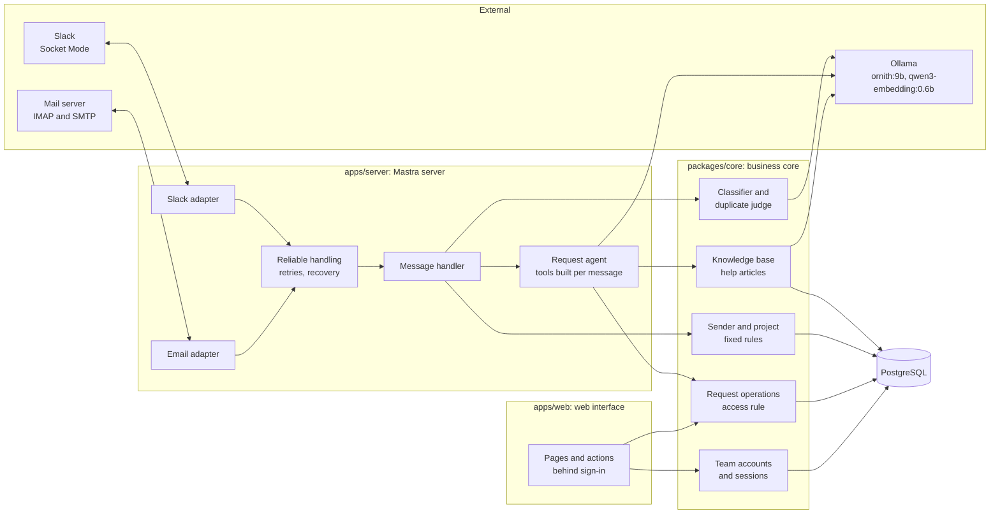
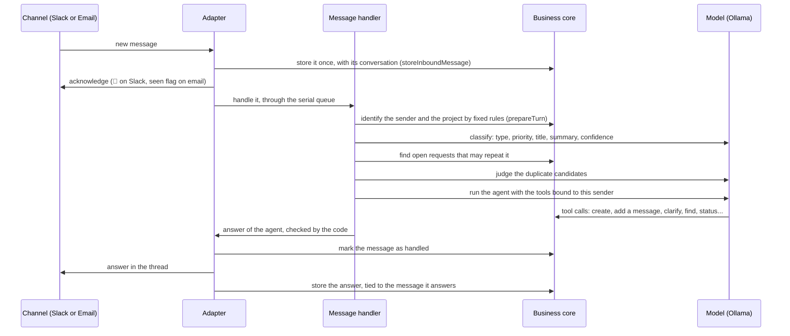

# Architecture

The system receives messages from Slack and from a mailbox, turns them into structured requests with a Mastra agent, and lets the team consult and validate them in a web interface. This page describes its parts, the path of a message, and how to add a channel. The reasons behind each choice are in [`decisions/`](decisions/).

## Parts

| Package         | Role                                                                                                                                                                       | Depends on         |
| --------------- | -------------------------------------------------------------------------------------------------------------------------------------------------------------------------- | ------------------ |
| `packages/core` | Data model, migrations, request operations and the access rule, classification and duplicate calls to Ollama, knowledge base, team accounts. Knows no channel and no agent | PostgreSQL, Ollama |
| `apps/server`   | Mastra server: the agent and its tools, the Slack and Email adapters, the retries and the recovery of unhandled messages                                                   | `packages/core`    |
| `apps/web`      | Web interface of the team: pages rendered on the server, sign-in, review actions                                                                                           | `packages/core`    |

Dependencies only point to the business core: the adapters, the agent and the web interface can change without touching it, and the core is tested alone against a real database.

## Path of a message

1. **Storing.** The adapter stores the message before anything else, with its original payload, so it is never lost and can always be traced back to its source. A message already stored, such as an event Slack sends twice, is ignored.
2. **Trust.** The adapter tells whether the channel verified the sender: Socket Mode for Slack, a DMARC result from the receiving mail server for email. The model never decides it.
3. **Fixed rules.** The sender is matched to a contact, and the project is found, in this order, from a channel dedicated to a project, a project key in the message, or the only project of the sender. Several possible projects make it ambiguous, and the agent may not pick one.
4. **Classification.** A separate call to the model gives the type, priority, title and summary, with a confidence read from its token probabilities. Thanks and advertisements stop here.
5. **Duplicates.** Open requests of the same project that share words or spelling with the message are given to the model, which names the one about the same problem, or none.
6. **Agent.** The agent receives the message wrapped as untrusted text, the information computed above, and tools built for this sender only. It acts on the message, looks up what the answer needs, and writes the answer, in 8 calls at most.
7. **Answer.** The code checks the answer of the agent before it is sent, and writes it from what the tools did when no answer passes the check ([decision 009](decisions/009-agent-answers.md)).
8. **Safety net.** A message the agent left unhandled is filed for a person. A failure is retried after 1 and 5 minutes, then filed for a person. At startup, each adapter handles again the messages stored but not handled.

The steps 3 to 7 are detailed in [`agent.md`](agent.md), the protections in [decision 003](decisions/003-agent-tools-security.md), and the duplicates and retries in [decision 007](decisions/007-duplicates-and-reliability.md).

## Data

Every request keeps its provenance and its full history: the messages it comes from, on which channel and from whom, its classification with the model and its confidence, and every change, made by the agent, the system or a named person. The history can only grow: the database refuses to change or delete an event. The tables are described in [`data-model.md`](data-model.md).

The application connects with a restricted database role, which can read, add and update rows, but cannot delete them, change the schema or rewrite the history.

## Observability

- **History of each request:** every decision of the agent is an event with its details, such as the classification, the model, the version of its instructions, the confidence and the reasons of a review. The web interface shows it.
- **Logs:** the adapters log their connection, and every failure with its message, through the Mastra logger. Tool inputs and message texts are not logged.
- **Measures:** `pnpm eval:classification` and `pnpm eval:duplicates` measure the model on labeled messages, so a change of model or instructions can be compared.

## Adding a channel

A new channel, such as Microsoft Teams or a web widget, is a new adapter in `apps/server`. The agent, the tools and the business core do not change. The adapter must:

1. Add the channel to the `channel` enumeration in `packages/core/src/db/schema.ts`, and generate the migration with `pnpm db:generate`.
2. Store each message received with `storeInboundMessage`, giving its conversation (thread) and its unique external ID, so a message delivered twice is stored once.
3. Decide whether the channel verified the sender, from what the channel itself proves, never from the content of the message.
4. Handle each stored message through `handleReliably` with the shared `handle` of `createChannelHandler`, one message at a time, so a failure is retried and then filed for a person.
5. Send the answer, then store it with `storeOutboundMessage`, with `inReplyTo` set to the external ID of the message it answers.
6. At startup, handle again the messages returned by `listUnhandledMessages` for the channel.
7. Start in `apps/server/src/mastra/index.ts` only when its configuration is present, like Slack and Email.

The Slack adapter (`apps/server/src/slack/`) and the Email adapter (`apps/server/src/email/`) follow these steps, and their tests show how to test an adapter with a fake channel.
