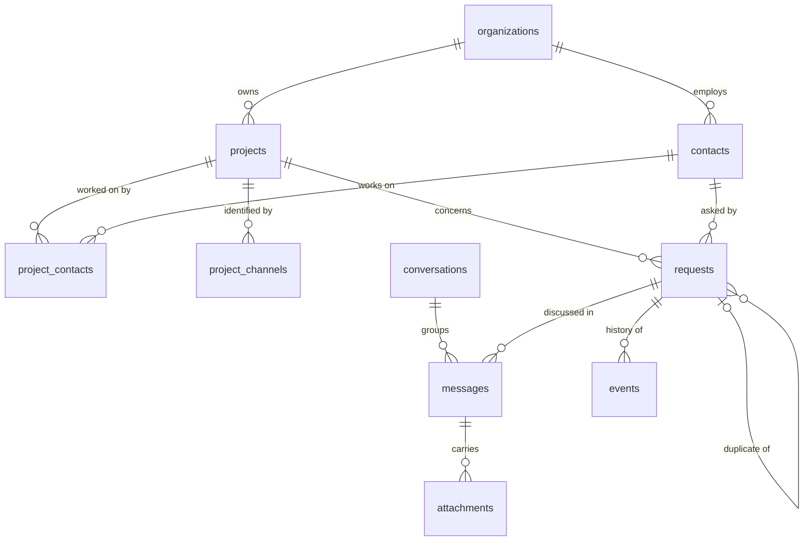

# Data model

The data model stores every request with its provenance and its full history. It is defined in [`packages/core/src/db/schema.ts`](../packages/core/src/db/schema.ts) with Drizzle ORM, and the SQL migrations generated from it are in [`packages/core/drizzle/`](../packages/core/drizzle/). The choice of PostgreSQL and Drizzle is explained in [decision 002](decisions/002-runtime-and-database.md).

## Overview



A message arrives in a conversation (a Slack thread or an email thread). The agent links it to a request: a new one, or an existing one when the message is a follow-up. Each action on a request adds an event to its history.

## Tables

### `organizations`

A client or internal company.

| Column         | Description                                                                     |
| -------------- | ------------------------------------------------------------------------------- |
| `name`         | Name of the organization                                                        |
| `email_domain` | Domain of its email addresses, such as `acme.example`. Unique, always lowercase |

### `contacts`

A person who writes to the agent.

| Column            | Description                             |
| ----------------- | --------------------------------------- |
| `organization_id` | Organization of the contact             |
| `name`, `role`    | Name and role, when known               |
| `email`           | Email address. Unique, always lowercase |
| `slack_user_id`   | Slack user ID. Unique                   |

A contact has at least an email address or a Slack user ID.

### `projects`

A project followed by the company.

| Column            | Description                                                             |
| ----------------- | ----------------------------------------------------------------------- |
| `key`             | Short code used by people, such as `SHOP`: 2 to 10 uppercase characters |
| `name`            | Full name                                                               |
| `description`     | What the project is about                                               |
| `organization_id` | Client organization                                                     |

### `project_contacts`

Who works on which project, with an optional `role`. When the sender of a message works on several projects, the project is ambiguous: the agent must not choose one at random.

### `project_channels`

A Slack channel or an email address dedicated to one project (`channel`, `external_id`). A message received there belongs to that project, without asking the language model.

### `conversations`

A logical group of messages.

| Column        | Description                                                                     |
| ------------- | ------------------------------------------------------------------------------- |
| `channel`     | `SLACK` or `EMAIL`                                                              |
| `external_id` | Slack thread (channel ID and thread timestamp) or Message-ID of the first email |
| `subject`     | Subject of the email thread                                                     |

### `messages`

A message received or sent, on any channel.

| Column              | Description                                                                                                         |
| ------------------- | ------------------------------------------------------------------------------------------------------------------- |
| `conversation_id`   | Conversation of the message. It must be on the same channel                                                         |
| `channel`           | `SLACK` or `EMAIL`                                                                                                  |
| `external_id`       | Slack message (channel ID and timestamp) or email Message-ID                                                        |
| `direction`         | `INBOUND` (received) or `OUTBOUND` (sent by the agent)                                                              |
| `request_id`        | Request the message belongs to, once identified                                                                     |
| `author_contact_id` | Author, once identified                                                                                             |
| `sender`            | Sender as given by the channel: email address or Slack user ID                                                      |
| `subject`           | Email subject                                                                                                       |
| `body_text`         | Text of the message                                                                                                 |
| `raw`               | Original payload received from the channel, to always be able to go back to the source                              |
| `in_reply_to`       | Message-ID of the email it answers                                                                                  |
| `sent_at`           | When the author sent it                                                                                             |
| `received_at`       | When the system received it                                                                                         |
| `handled_at`        | When the system finished with an inbound message. Empty while it waits to be handled, so a restart handles it again |
| `handling_attempts` | Failed attempts to handle the message                                                                               |

A message is stored only once for a given channel and external ID, so an email processed twice does not create a second request.

### `attachments`

Files attached to a message: `filename`, `content_type`, `size_bytes`, and `storage_ref`, the location of the stored file, empty when only the metadata is kept.

### `requests`

A structured request.

| Column                            | Description                                                                                                  |
| --------------------------------- | ------------------------------------------------------------------------------------------------------------ |
| `number`                          | Sequential number, shown to people as a reference such as `REQ-0042`                                         |
| `project_id`                      | Project concerned. Empty while it is unknown                                                                 |
| `requester_contact_id`            | Who made the request                                                                                         |
| `type`                            | `BUG`, `FEATURE_REQUEST`, `CHANGE_REQUEST`, `EVOLUTION`, `SUPPORT`, `FOLLOW_UP`, `STATUS_REQUEST` or `OTHER` |
| `status`                          | `NEW` (default), `IN_PROGRESS`, `WAITING_FOR_INFO`, `RESOLVED` or `CLOSED`                                   |
| `priority`                        | `LOW`, `MEDIUM`, `HIGH` or `CRITICAL`. Empty when it cannot be estimated                                     |
| `title`, `summary`, `description` | Content extracted from the messages                                                                          |
| `source_channel`                  | Channel of the first message                                                                                 |
| `confidence`                      | Confidence of the agent in its classification, from 0 to 1                                                   |
| `needs_review`                    | The request waits for a human validation                                                                     |
| `duplicate_of_request_id`         | Original request, when this one is a duplicate                                                               |
| `search`                          | Computed by the database from the title, summary and description, for text search                            |

The `search` column uses the French configuration of PostgreSQL, so a search for "paiements" also finds "paiement". A word found in the title ranks above a word found in the summary, which ranks above the description.

### `events`

The history of each request.

| Column             | Description                                                                                                                                            |
| ------------------ | ------------------------------------------------------------------------------------------------------------------------------------------------------ |
| `request_id`       | Request concerned                                                                                                                                      |
| `type`             | `CREATED`, `CLASSIFIED`, `UPDATED`, `STATUS_CHANGED`, `MESSAGE_ADDED`, `CLARIFICATION_REQUESTED`, `REVIEW_REQUESTED`, `REVIEWED` or `MARKED_DUPLICATE` |
| `actor_type`       | Who acted: `AGENT`, `HUMAN` or `SYSTEM`                                                                                                                |
| `actor_contact_id` | The person, when a human acted                                                                                                                         |
| `channel`          | Channel the action came from                                                                                                                           |
| `message_id`       | Message that caused the event                                                                                                                          |
| `data`             | Details: changed values, classification, confidence, reason                                                                                            |

Events can only be added. A database trigger rejects any update or deletion, so the history cannot be rewritten.

## Conventions

- Identifiers are UUIDv7, generated by PostgreSQL: unique and ordered by creation time.
- Dates are stored with their time zone.
- Fixed lists of values (types, statuses, priorities, channels) are PostgreSQL enumerations. A value can be added later with a migration.
- `created_at` is set by the database. `updated_at` is set by the application on each update.

## Changing the model

1. Edit `packages/core/src/db/schema.ts`.
2. Generate the migration, then read the SQL file it creates in `packages/core/drizzle/`:

   ```bash
   pnpm db:generate --name describe_the_change
   ```

3. Apply it to the development database:

   ```bash
   pnpm db:migrate
   ```

The tests apply the migrations to the test database automatically.

## Demo data

`pnpm db:seed` inserts fictitious data, and running it again updates the same rows instead of duplicating them:

| Project  | Organization | Contacts                   | Dedicated channel                              |
| -------- | ------------ | -------------------------- | ---------------------------------------------- |
| `SHOP`   | Acme         | Alice Martin, Chloé Durand | Slack channel `C000000SHOP`                    |
| `CRM`    | Acme         | Alice Martin, Chloé Durand | None                                           |
| `PORTAL` | Globex       | Bruno Leroy, Chloé Durand  | Email address `portal-support@initech.example` |

Alice Martin works on two projects, so her messages exercise the ambiguity handling.
